  <picture>
    <source media="(prefers-color-scheme: dark)" srcset="https://raw.githubusercontent.com/TerminalExplore/terminalexplore/master/assets/terminal-dark.svg">
    <source media="(prefers-color-scheme: light)" srcset="https://raw.githubusercontent.com/TerminalExplore/terminalexplore/master/assets/terminal-light.svg">
    
  </picture>

<picture>
  <source media="(prefers-color-scheme: dark)" srcset="https://profile-views.terminalexplore.workers.dev/?username=TerminalExplore&theme=dark">
  <source media="(prefers-color-scheme: light)" srcset="https://profile-views.terminalexplore.workers.dev/?username=TerminalExplore&theme=light">
  
</picture>

